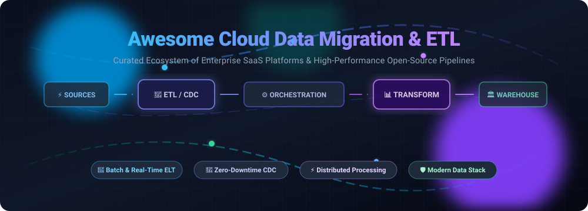

# 🚀 Awesome Cloud Data Migration & ETL ☁️🔄

 

  <b>A curated list of leading SaaS products and battle-tested open-source projects for Cloud Data Migration, ELT/ETL Orchestration, Zero-Downtime CDC Replication, and Data Warehouse Ingestion.</b>

---

## 📑 Table of Contents
- [🎯 Overview & Architecture](#-overview--architecture)
- [📈 Sector Overview & Market Dynamics](#-sector-overview--market-dynamics)
- [🏢 SaaS & Hosted Cloud Platforms](#-saas--hosted-cloud-platforms)
- [💻 Open-Source GitHub Projects](#-open-source-github-projects)
- [🤝 How to Contribute](#-how-to-contribute)
- [💖 Support & Community](#-support--community)
- [⭐ Star History](#-star-history)
- [⚠️ Disclaimer](#️-disclaimer)

---

## 🎯 Overview & Architecture

This repository tracks the modern data integration ecosystem across **enterprise SaaS solutions** and **open-source frameworks** for **Cloud Data Migration & ETL/ELT**. These tools empower data engineers, analytics engineers, and platform teams to extract, load, transform, and sync data between operational sources (RDBMS, NoSQL, SaaS apps, webhooks, REST APIs) and analytical destinations (Snowflake, Google BigQuery, Databricks, Amazon Redshift, and Iceberg/Delta Lake data lakes).

Key capabilities covered:
- 🔄 **Automated ELT Pipelines & Ingestion**: Scheduled high-throughput ingestion with automated schema drift handling.
- ⚡ **Zero-Downtime Change Data Capture (CDC)**: Low-latency log-based replication from production transactional databases.
- 🏗️ **In-Warehouse Transformation & dbt Modeling**: Push-down SQL/Spark transformation executed directly inside target data warehouses.
- 🧭 **Workflow Orchestration & Lineage**: DAG-driven scheduling, end-to-end data observability, and dependency tracking.

---

## 📈 Sector Overview & Market Dynamics

The global cloud data integration and ETL market is estimated at **$14B–$17B in 2025–2026** (projected to surpass **$21B by 2028–2030** with a ~10–13% CAGR), driven by enterprise cloud modernization, distributed data estates, and foundational generative AI readiness demands. 

The sector exhibits a **moderately fragmented, barbell concentration structure**:
- 🏛️ **Hyperscaler & Enterprise Consolidation**: Cloud giants (Microsoft Azure, AWS, Google Cloud) and enterprise data management suites (Informatica, Qlik/Talend) control massive baseline infrastructure commitments.
- ⚡ **Dynamic Modern Data Stack (MDS) Tier**: A vibrant, highly competitive landscape of specialized SaaS leaders (Fivetran, Matillion, Hevo) and rapidly expanding open-core communities (Airbyte, dbt, Debezium, Dagster) powers developer-first, flexible pipeline workflows.

---

## 🏢 SaaS & Hosted Cloud Platforms

*Ranked in descending order of company scale, market valuation, and enterprise footprint.*

| Product | Company Scale (Valuation / Revenue) | Description | Pricing (Starting) | Free Tier / Trial Limits |
|---|---|---|---|---|
| **[Azure Data Factory](https://azure.microsoft.com/en-us/products/data-factory/)** | Microsoft: **$3.1T+ Market Cap** (~$245B+ Annual Rev) | Serverless cloud ETL/ELT orchestration service integrating data across hybrid clouds with native Azure ecosystem support. | **$0.25/DIU-hour** (data movement) + **$0.274/vCore-hour** (data flows) + **$1.00/1,000 cloud activity runs** | **Always-free tier**: 5 low-frequency activity runs/month; **30-day free trial**: $200 Azure cloud credits |
| **[AWS DMS](https://aws.amazon.com/dms/)** | Amazon / AWS: **$2.0T+ Market Cap** (~$105B+ AWS Annual Rev) | Managed database migration and replication service supporting continuous CDC replication to AWS data lakes and warehouses. | **$0.065/hour** (~$47/month for `dms.t3.medium`) or **$0.0384/hour** (for `dms.t3.small`) + $0.115/GB-month storage | **AWS Free Tier (12 months)**: 750 hours/month of Single-AZ replication instance (`dms.t3.micro`/`dms.t3.small`) + 50GB storage |
| **[Zoho DataPrep](https://www.zoho.com/dataprep/)** | Zoho Corp: **~$12B–$15B Est. Valuation** (~$1.5B FY25 Revenue) | Self-service data preparation, cleaning, and pipeline integration platform with 250+ transforms and reverse-ETL connectors. | **$40/month** (billed annually) for Standard plan (2M rows/month, 3 users) | **Free plan**: 20,000 rows/month, 1 user, 1-month audit log retention; **15-day free trial** of paid plans |
| **[Stitch Data](https://www.stitchdata.com/)** | Qlik / Thoma Bravo: **~$10B Valuation** (~$1B+ Revenue) | Simple, developer-focused cloud ELT platform extracting data from SaaS applications and databases into warehouses. | **$100/month** for Standard plan (5M rows/month, 1 destination, up to 10 sources) | **14-day free trial**: unlimited rows and connections, no credit card required |
| **[Talend (Qlik Talend Cloud)](https://www.talend.com/)** | Qlik / Thoma Bravo: **~$10B Valuation** (~$1B+ Revenue) | Enterprise data integration, quality governance, and pipeline transformation suite across multi-cloud environments. | **$6,000/year** (~$500/month) for Starter plan (up to 50GB/month data volume) | **14-day free trial**: full cloud platform features, no credit card required |
| **[Informatica Cloud Data Integration](https://www.informatica.com/)** | Informatica: **~$7.6B–$8.0B Valuation** (~$1.6B+ Revenue) | Enterprise-grade iPaaS and ETL platform featuring extensive governance, enterprise connectors, and automated mapping pipelines. | **$1,098/IPU-year** (~$91.50/IPU-month; standard AWS Marketplace entry at $131,760/year for 120 IPUs/month) | **CDI-Free plan**: 20M rows/month, 10 compute hours/month, 25 IPUs/month (requires corporate work email); **30-day free trial** |
| **[Fivetran](https://www.fivetran.com/)** | Fivetran: **$5.6B Valuation** (~$300M+ ARR; merged with dbt Labs) | Fully managed automated ELT platform featuring 700+ connectors with automated schema drift detection and in-warehouse transformation. | **$5/month base charge** per connection (generating 1–1M MAR) on Standard pay-as-you-go | **Free plan**: 500,000 MAR/month for connectors, 3,500 MAR/month for reverse ETL activations, 5,000 monthly model runs for dbt transformations; **14-day free trial** |
| **[Airbyte](https://airbyte.com/)** | Airbyte: **$1.5B Valuation** (Series B Unicorn) | Open-core ELT engine with managed cloud hosting, credit-based volume scaling, and 300+ community and native connectors. | **$20/month** for Standard plan (includes 5 credits, $5/additional credit) | **Free plan (Airbyte Cloud)**: 1,000 Action Operations (AOs)/month, single user; **30-day free trial** with $500 free credits |
| **[Matillion](https://www.matillion.com/)** | Matillion: **$1.5B Valuation** (Series E Unicorn) | Warehouse push-down ELT and transformation engine designed natively for Snowflake, Databricks, Redshift, and BigQuery. | **~$2.00–$2.50/credit** via credit packages (Teams tier typically starts around ~$20,000/year; 1 credit/task-hour for orchestration, 3 credits/task-hour for transform) | **14-day free trial**: 500 free credits included, full platform capabilities |
| **[Hevo Data](https://hevodata.com/)** | Hevo Data: **~$300M–$400M Est. Valuation** (~$35M–$45M ARR, $43M funded) | Real-time, no-code data pipeline and replication platform offering fault-tolerant ELT ingestion from 150+ sources. | **$265/month** (billed annually, or $299/month monthly) for Starter plan (5M events/month, 10 users) | **Free plan**: 1,000,000 events/month, unlimited free sources, up to 5 users; **14-day free trial** of paid features |

---

## 💻 Open-Source GitHub Projects

*Ranked in descending order by GitHub_Stars_Count ⭐.*

| Project | GitHub_Stars | Description | Category |
|---|---|---|---|
| **[Apache Airflow](https://github.com/apache/airflow)** |  | Industry standard programmatic workflow orchestration platform for authoring, scheduling, and monitoring complex data engineering DAGs. | Orchestration |
| **[Apache Spark](https://github.com/apache/spark)** |  | Unified multi-language engine for large-scale distributed data processing, batch ETL, and high-velocity streaming computations. | Processing & ETL |
| **[Apache Kafka](https://github.com/apache/kafka)** |  | Distributed event streaming platform used by thousands of companies for high-performance data pipelines, streaming analytics, and data integration. | Streaming & CDC |
| **[Apache Flink](https://github.com/apache/flink)** |  | High-throughput, low-latency framework and distributed processing engine for stateful stream processing and unified batch analytics. | Stream Processing |
| **[Prefect](https://github.com/prefecthq/prefect)** |  | Modern Python workflow orchestration and data pipeline coordinator designed for resilience, dynamic task execution, and cloud observability. | Orchestration |
| **[Airbyte (OSS)](https://github.com/airbytehq/airbyte)** |  | Open-source data integration platform with 300+ connectors. Self-hosted ELT deployment that extracts and loads data reliably into warehouses. | ELT Ingestion |
| **[Dagster](https://github.com/dagster-io/dagster)** |  | Cloud-native, asset-based orchestrator for machine learning, analytics, and ETL pipelines with integrated software-defined assets. | Orchestration |
| **[dbt (data build tool)](https://github.com/dbt-labs/dbt-core)** |  | SQL-first in-warehouse transformation framework enabling analytics engineering best practices, version control, testing, and CI/CD. | Transformation |
| **[Debezium](https://github.com/debezium/debezium)** |  | Distributed open-source Change Data Capture (CDC) platform capturing row-level database changes (PostgreSQL, MySQL, MongoDB, SQL Server) in real time. | CDC & Replication |
| **[Apache SeaTunnel](https://github.com/apache/seatunnel)** |  | High-performance, distributed, massive-volume data integration tool capable of synchronizing billions of data records daily across 100+ sources. | Data Integration |
| **[CloudQuery](https://github.com/cloudquery/cloudquery)** |  | High-performance open-source ELT framework designed for cloud infrastructure, security data lakes, and developer APIs to any SQL or cloud storage. | Cloud ELT |
| **[Apache NiFi](https://github.com/apache/nifi)** |  | Visual dataflow system supporting powerful, scalable directed graphs of data routing, transformation, and system mediation logic. | Dataflow & ETL |
| **[Meltano](https://github.com/meltano/meltano)** |  | Declarative, GitOps-ready data integration and ELT engine built around Singer taps/targets and dbt transformation workflows. | ELT Framework |
| **[Sling CLI](https://github.com/slingdata-io/sling-cli)** |  | Fast, lightweight CLI tool and pipeline engine for moving data between databases, cloud buckets, and analytical warehouses with YAML configs. | Fast Data Loader |
| **[Singer Standard](https://github.com/singer-io)** |  | Open-source specification for composable data extraction (taps) and loading (targets), forming the baseline for modular ELT integrations. | ELT Specification |

💡 **Pro-Tip for Self-Hosted Architecture**: Combine **Airbyte OSS** or **Sling CLI** for extraction/loading, **Debezium** for sub-second CDC streaming, **dbt Core** for in-warehouse SQL transformations, and **Apache Airflow** or **Dagster** for orchestration to build a 100% self-hosted, cloud-native data platform without per-row or per-credit licensing fees.

---

## 🤝 How to Contribute

Contributions are warmly welcomed! Help make this curated guide the most comprehensive and up-to-date cloud data migration reference:

1. 🍴 **Fork the repository**.
2. 🌿 **Create a new branch**: `git checkout -b feature/add-new-tool`.
3. 📝 **Add or update entries** following the table format (include official links, factual description, specific pricing/limits, or GitHub Stars_Badge).
4. 🚀 **Submit a Pull Request** with a concise description of your changes.

---

## 💖 Support & Community

If you find this repository helpful for your data engineering journey, architecture design, or vendor evaluation, please consider supporting the project:

- ⭐ **Star this repository** to help others discover it on GitHub!
- 🍴 **Fork and share** with your data team and colleagues.
- 💬 **Join the Discussion** on our [Discord Community](https://discord.gg/jc4xtF58Ve) to chat about data architecture and modern ETL patterns.
- ☕ **Buy a Coffee / Sponsor**: Support ongoing maintenance and curation via the [GitHub Sponsor Dashboard](https://github.com/sponsors/ishandutta2007).

---

## ⭐ Star History

---

## ⚠️ Disclaimer

- This is a community-curated educational repository and does not constitute commercial endorsement.
- Cloud data migration and ETL pipelines handle critical, sensitive production records. Always implement encryption in transit and at rest, principle of least privilege (PoLP) access credentials, and audit logging.
- Pricing models (MAR, IPU, vCore-hours, DIUs, task credits) vary across vendors and can produce unexpected cloud spend at scale. Always model total operational expenses against your expected data velocity, row change frequency, and pipeline retention requirements before entering enterprise commitments.
